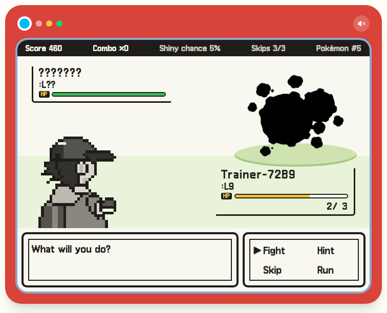
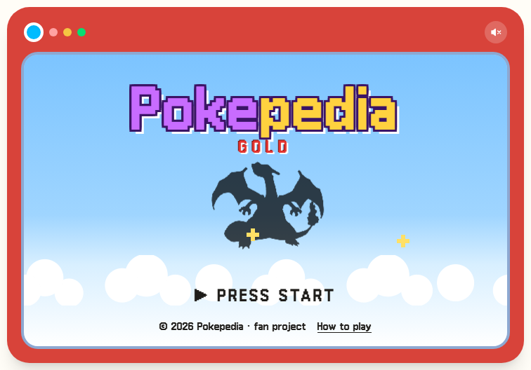
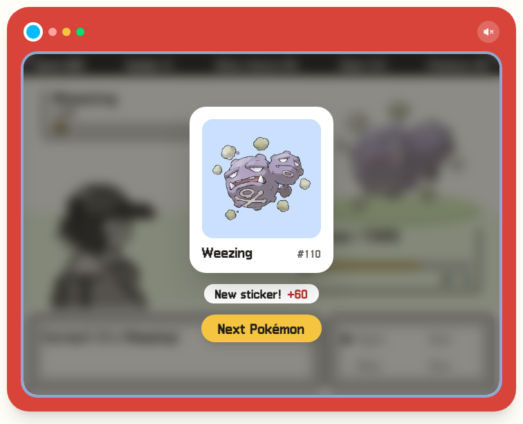
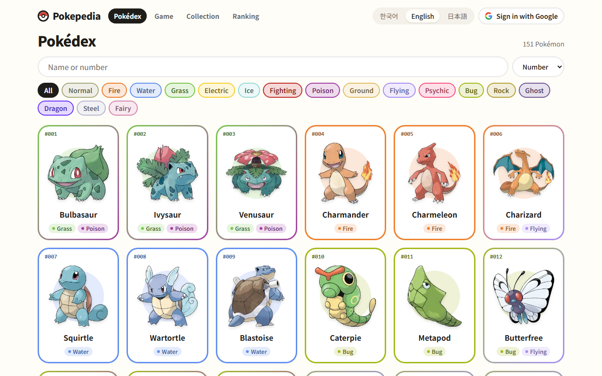
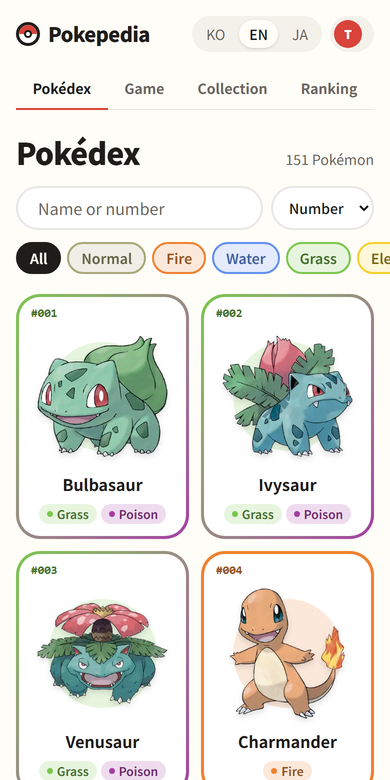
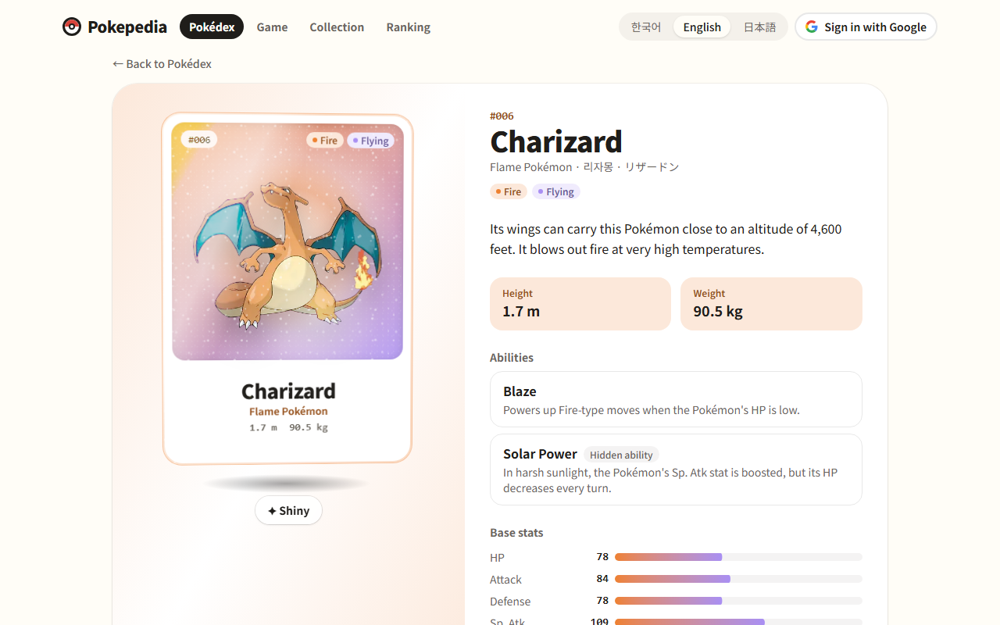
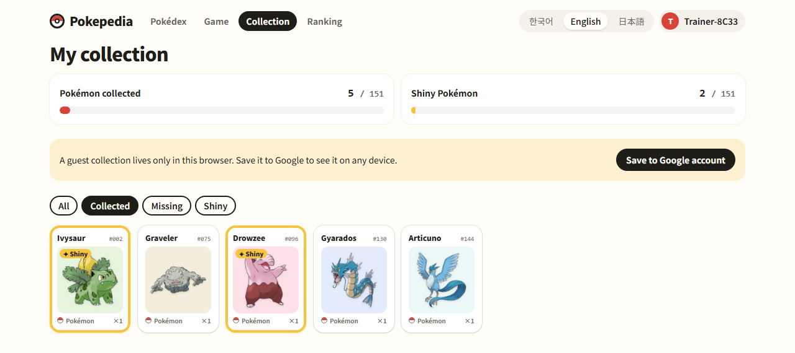
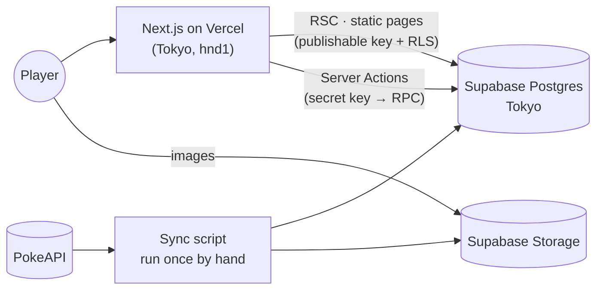

# Pokepedia

**Who's that Pokémon?** A Game Boy–style silhouette battle, a Gen 1 Pokédex, 
and a sticker book that fills up every time you get one right.

### [Play at pokepedia.dev →](https://pokepedia.dev)

 

 

A silhouette appears. Name it (in English, Korean or Japanese) and it's yours as a sticker.
Miss three times and the run is over.

This is a remake of [PikapediaProject](https://github.com/ottuck/PikapediaProject), a JSP-only app
from back when I was first learning to code. I rebuilt it from scratch on a modern stack, mostly
because it was fun.

## The game

<table>
  <tr>
    <td width="50%"></td>
    <td width="50%"></td>
  </tr>
</table>

- **Fight** to answer, **Hint** for half the name, **Skip** to move on, **Run** to call it a day. Arrow keys and Z work too.
- Wrong answers cost HP. A streak raises the score multiplier and the odds of a shiny sticker.
- Pikachu, 피카츄 or ピカチュウ: any of the three names counts.
- No sign-up. You start as a guest, and linking a Google account later keeps everything you've collected.

## The Pokédex

<table>
  <tr>
    <td width="74%"></td>
    <td width="26%"></td>
  </tr>
</table>

- All 151 on one page. Search by name in any of the three languages or by number. Type filters and sort order are kept in the URL.
- Each one has stats, abilities and its evolution line. The artwork is a holographic card that tilts with your cursor (or finger), and flips to its shiny version with a tap.

## The sticker book

151 slots to fill, shinies included, plus a leaderboard of everyone's best runs.

## Under the hood

Next.js 16 (App Router, RSC, Server Actions) · React 19 · TypeScript · Tailwind CSS v4 · Motion ·
Zustand · Zod · next-intl · Supabase (Postgres, Auth, Storage) · Vitest · Playwright · Vercel

- Pokémon data and artwork are pulled from PokeAPI once and stored in Supabase; nothing calls an outside API at runtime.
- The dex and all detail pages (151 × 3 languages) are prerendered at build time.
- Answers are checked on the server, so the correct name never reaches the browser.

The longer story (schema, game rules, how guests merge into Google accounts, what's tested and why) is in the [design notes](docs/system_design.md).

---

Source code: [MIT](LICENSE). Pokémon and all related names and artwork belong to Nintendo, The Pokémon Company, Creatures Inc. and GAME FREAK inc., and are not covered by the MIT License. This is an unofficial, non-commercial fan project, not affiliated with or endorsed by them.
