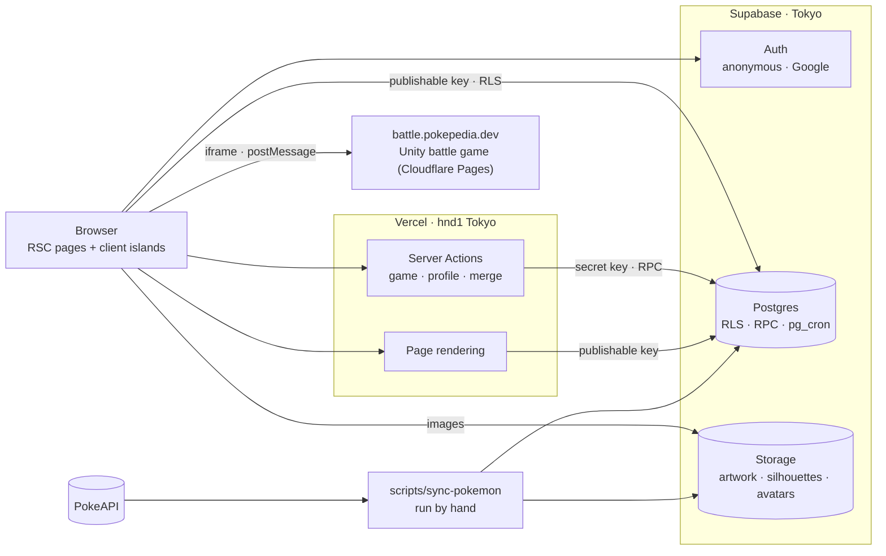

# Pokepedia System Design

This document collects only the parts of Pokepedia's structure and rules that are hard to see from the code alone. Changes to the structure update this document first.
The introduction and how to run the project are in the [README](../README.md). The UI calls it the "game", but the code uses `quiz` (`features/quiz`).

- [1. Architecture](#1-architecture)
- [2. Data](#2-data)
- [3. Database and permissions](#3-database-and-permissions)
- [4. Rendering and i18n](#4-rendering-and-i18n)
- [5. Game](#5-game)
- [6. Accounts](#6-accounts)
- [7. Development and deployment](#7-development-and-deployment)
- [8. Testing](#8-testing)

## 1. Architecture



| Area     | Decision                                                                                                                  |
| -------- | ------------------------------------------------------------------------------------------------------------------------- |
| Scope    | Generation 1, #001–151. Types follow the current official data (Clefairy = Fairy). Evolutions are cut off at Generation 1 |
| Data     | PokeAPI is used only by the sync script. Nothing calls an outside API at runtime                                          |
| Writes   | The browser reads only what RLS allows; writes that change game state go only through Server Action → RPC                 |
| State    | Server data lives in RSC; client state (Zustand) only on the game screen                                                  |
| Region   | Vercel functions (`hnd1` in `vercel.json`) and Supabase both sit in Tokyo (below)                                         |
| Excluded | TanStack Query, Drizzle, GSAP. Reconsider when a concrete problem appears                                                 |

**Region**: from Washington (`iad1`), the Vercel function default, every query to the Tokyo database took about 170 ms, and a single answer took 1.6–2.5 s. Moving the functions to Tokyo and cutting sequential database round trips from 8 to 3 brought it to about 0.25 s. If the database region moves, change `vercel.json` with it.

**Environments**: one remote Supabase project (`pokepedia`) serves both Vercel Production and Preview. Playing the game on a Preview creates real data. Per-PR Supabase Branching is a paid feature and is not used; database changes are verified in CI and on local Supabase (`pnpm supabase start`). The production domain is `pokepedia.dev`.

## 2. Data

```
pnpm sync:pokemon  (run by hand locally, idempotent)
  ① Fetch species / pokemon / evolution-chain / ability for 1–151 from PokeAPI (raw responses cached in .cache/)
  ② Validate with Zod → convert to DB rows
  ③ sharp: artwork webp (normal, shiny) + black silhouette webp
  ④ Upload to Storage + apply to the DB with a single RPC sync_pokemon_catalog
```

- The default target is local (`.env.local`). Remote runs only with `--env-file .env.remote.local --yes`, and only when the user asks for it.
- The dex is prerendered at build time, so the result of a remote sync shows only after the next deployment.
- A silhouette file name is the first 16 characters of `HMAC-SHA256(SILHOUETTE_SECRET, id)`. It is only enough to keep the answer from being read straight off the file name.
- Answer keys are built with `features/quiz/normalize.ts`, the same code that grades the game.
- Buckets: `pokemon-artwork`, `quiz-silhouette` (both public, writable only with the secret key), `avatars` (§6).
- `supabase/seed.sql` is a 3-Pokémon catalog for local and CI (no images). It is never applied to production.

## 3. Database and permissions

```sql
-- Pokédex (public read)
pokemon (id 1–151, name/genus/description × ko·en·ja, type_1, type_2, height·weight, 6 base stats,
         evolves_from_id, evolution jsonb, artwork_path, shiny_artwork_path, is_legendary, is_mythical)
ability, pokemon_ability

-- Game secrets: a private schema not exposed through the Data API
private.pokemon_quiz (pokemon_id, silhouette_path, answer_keys text[])

-- Users
profile      (id → auth.users, nickname 2–20 chars, avatar_path,
              nickname_adjective_id, avatar_pokemon_id)            -- created by a sign-up trigger
nickname_adjective (id, name_ko/en/ja)                              -- adjective of the generated name (public)
quiz_run     (user_id, status, end_reason fainted|fled, score, combo, best_combo, skips_left …)
quiz_round   (run_id, seq, pokemon_id, status active|cleared|failed|skipped, hp, hint_used, version …)
user_sticker (user_id, pokemon_id, variant normal|shiny, quantity)
private.guest_merge_ticket (token_hash, from_user_id, expires_at, consumed_at)
```

- Each user has at most one run and one round in progress (partial unique index).
- A sticker is Pokémon × variant, so there is no separate sticker table. Results and recent rewards are read from `quiz_round`.

**Permissions**: the publishable key is public, so anything granted to `anon`/`authenticated` is treated as callable by anyone directly from a browser.

| Target                                         | anon / authenticated                                                      |
| ---------------------------------------------- | ------------------------------------------------------------------------- |
| `pokemon`, `ability`, `pokemon_ability`        | SELECT                                                                    |
| `private.*`                                    | None                                                                      |
| `profile`                                      | SELECT own row, UPDATE of the `nickname` column only                      |
| `quiz_run`, `user_sticker`                     | SELECT own rows                                                           |
| `quiz_round`                                   | SELECT own rows, finished rounds only (the current question stays hidden) |
| Game, merge and cleanup RPCs                   | None (only the server, using the secret key)                              |
| `leaderboard(_entries)`, `my_leaderboard_rank` | EXECUTE (the only public window: returns just name, score and combo)      |
| `nickname_adjective`                           | SELECT for everyone                                                       |
| storage `avatars`                              | INSERT/DELETE only in the user's own folder, Google accounts only         |

- New tables get no privileges by default (`api.auto_expose_new_tables = false`). Each migration grants only what is needed.
- Layers of defense: `proxy.ts` (session refresh, locale) → Server Action / RSC (user checked with `getClaims()`) → RLS (the last line of defense).

## 4. Rendering and i18n

| Route                                  | Rendering    | Client parts                                 |
| -------------------------------------- | ------------ | -------------------------------------------- |
| `/[locale]` (home)                     | Static shell | All of `QuizGame`                            |
| `/[locale]/pokedex`                    | Static       | `PokedexExplorer`: filter, search, sort      |
| `/[locale]/pokemon/[id]`               | SSG 151 × 3  | Holographic card, "My stickers" badge        |
| `/[locale]/leaderboard`                | ISR 60 s     | "My rank"                                    |
| `/[locale]/collection`, `/[locale]/me` | Dynamic      | Filters, card effects, nickname/avatar edits |
| `/[locale]/battle`                     | Dynamic      | `BattleFrame`: Unity game iframe             |

- The first screen is the game's title screen. The dex moved to `/pokedex`, and the redirects in `next.config.ts` catch the old addresses (`/[locale]/quiz` → `/[locale]`, and `/[locale]?type=…` with filters → `/[locale]/pokedex`).
- The dex and detail pages are read with a cookie-less client (`lib/supabase/public.ts`) and built at build time. With `dynamicParams = false`, ids outside the list return 404 without a database query.
- The UI is mobile-first. Even on wide screens, every page, the header and the footer share the same narrow, centered column (`max-w-page`, 42rem). The column is a card running from top to bottom (background color + a soft shadow), and on wide screens the area outside it is `--backdrop`, one shade darker, so the app looks like a screen floating in the middle (on a phone the column fills the width and this does not show). This removes the varying widths pages used to have, and most users are on phones. On every screen the header is one row of logo, language and account plus a menu tab bar (Game → Battle → Pokédex → Collection → Ranking). The language picker opens a list from a globe + code button (no flags: a language is not a country, and Windows renders flag emoji as letters). Header popovers attach directly below their button (`components/anchored-popover.ts`). The game device and the battle device are the width of this column too, and the battle screen sits centered inside it at an integer scale.
- The header account menu and the "My stickers" badge are read in the browser with the session and RLS, because reading cookies in the layout would turn every static page dynamic.
- On the dex and the collection, the server renders the cards and passes them as props; the client only decides which cards to show and in what order. Filter state is synced with the URL (`?q=&type=&sort=`).
- OG images (a site default + one per Pokémon, 151 × 3) are generated at build time.
- i18n: next-intl with `ko` (default), `en` and `ja`; the URL always carries the locale. UI copy lives only in `messages/*.json`, and the server returns only a `code`. A test checks that every language has the same keys.

## 5. Game

**Rules** (constants and pure functions in `features/quiz/rules.ts`)

```
Run   : score, combo, skips_left = 3
Round : hp = 3, one hint

Fight (correct) → points + sticker → next round
Fight (wrong)   → hp −1, combo = 0. At hp 0 the answer is revealed and the run ends (fainted)
Hint            → reveals the first half of the name, combo = 0, this round's points ×0.5
Skip            → skips_left −1, combo = 0, no points or sticker
Run away        → the run ends (fled)
```

- Points: `base[hp] × hint multiplier × combo multiplier`. `base = {3: 100, 2: 60, 1: 30}`; the combo multiplier caps at ×2.0.
- Shiny sticker odds: combo 1–4 → 5%, 5–9 → 10%, 10 or more → 20%. A round that used the hint → 5%.
- One-character names (Mew in Korean) reveal nothing with the hint.
- Names in all three languages are accepted. Input and answer keys are normalized by the same rules (case, full-width/half-width, hiragana → katakana, spaces and symbols removed).
- The next Pokémon is chosen by a server-side CSPRNG from those not yet shown in this run.
- **First Pokémon**: a player without a Pikachu sticker (normal or shiny) gets Pikachu as the first question of a new run. Answering it unlocks battling with that sticker (see Battle below), so the reward screen has a "Battle with my Pikachu" button. The first time, to lead the first experience into a battle, only that one gold-bordered button is shown (the run in progress stays, and resumes on return); on later rewards it sits next to "Next Pokémon". This is decided from `user_sticker` with no extra stored value, so it is the same on every device and cannot be tampered with. The lookup happens only when a new run is created, together with the catalog query, so it adds no sequential round trip.

**API** (`features/quiz/actions.ts`): `startQuiz`, `submitAnswer`, `requestHint`, `skipQuizRound`, `fleeQuiz`. Input is validated with Zod, and the user always comes from the session. Without a session, `startQuiz` signs in anonymously.

- **Decide in TS, commit in SQL**: `service.ts` reads the trusted state and computes the outcome with `rules.ts`. A single RPC, `quiz_commit`, applies it in one transaction (update round → update run → sticker → next round). Optimistic locking on `version` means sending the same answer twice applies it once.
- The current run and round are read from the same snapshot of a single SQL query. Even if a correct answer and running away in another tab overlap, an old score is never saved mixed with a new round's version, and a round that changed is treated as a conflict.
- **Answers never exposed**: the round sent to the browser carries no Pokémon id or name, only the silhouette file name and the name mask, and RLS hides the round in progress as well.
- **Database round trips**: 3 sequential round trips for a correct answer, 2 for a wrong answer or hint (§1 Region). Tests keep this from growing.
- **Screen**: the Zustand `useQuizStore` calls the actions, and the phase (`lobby → intro → menu ⇄ answering → judging → hit | reveal → reward → … → gameover`) only decides in what order to present the server's result. Reloading returns to the lobby, and starting resumes the run in progress. Other commands can be pressed while typing a name (the input closes). On phones, when a battle starts the page scrolls so the device fits on one screen, and touches on the device do not scroll the page.
- **Battle**: the battle is a Unity web game in a separate repository, `pokepedia-unity`, loaded in an iframe from `https://battle.pokepedia.dev` (Cloudflare Pages). The `/battle` page reads the session's `user_sticker` on the server, and answers the game's `ready` message (origin checked) with every owned sticker in `init` (`features/battle/host.ts`). The game decides which Pokémon can battle (only Pikachu for now; without it, the game explains and offers a demo). In the collection, stickers that can battle get a gold border (distinct from the yellow border of shiny stickers) and a "Battle" badge, making them an entrance to the game. The battle-ready Pokémon ids live in `BATTLE_PLAYABLE_IDS`, matching `playable` in the game's `roster.json`. Battle results are not saved and carry no rewards or ranking, so there are no database changes. The single source of truth for the message protocol is §9.2 of `docs/PROJECT.md` in `pokepedia-unity`.
- **Recovery**: on a conflict, `startQuiz({ resumeOnly: true })` re-reads only the run in progress. If another tab ended it or the resync fails, the game returns to the title screen with an error and the player retries with START; it never creates a new game or guest automatically. Signing out or a user change resets the client game state, and late results of requests started before the reset are ignored.

## 6. Accounts

- The dex works without signing in. Starting the game makes the player a guest (anonymous sign-in).
- **Linking Google**: signed-out users use `signInWithOAuth`; guests use `linkIdentity` to attach Google to the same user id and keep their records. `/auth/callback` only redirects to same-origin paths.
- **Merging guest records**: `linkIdentity` fails if the Google account is already registered. In that case the guest's records can be merged into that account.
  1. `prepareGuestMerge` creates a one-time ticket. The database stores only a hash of the token (10 minutes); the raw token is sent only as an httpOnly cookie.
  2. After signing in with Google, `/auth/callback` calls the RPC `guest_merge_redeem`, which consumes the ticket, moves the game records and adds up the stickers in one transaction.
  3. The guest user is deleted only after the move succeeds.
- **Cleaning up inactive guests**: pg_cron runs `cleanup_inactive_guests()` daily. It deletes only accounts that are guests, have been inactive for more than 60 days, own zero stickers and have no game in progress.
- The cleanup RPC's `p_user_ids` overload checks only the given users. An empty array deletes nobody, and the existing signature and the cron call keep the full scope. Tests pass only the user ids they created.
- **Profile**: the sign-up trigger picks a random adjective (30 of them, mostly the games' "natures") and a Pokémon, giving a generated name like "Brave Pikachu". Only the adjective and Pokémon number are stored, and they are read in the viewer's language (it doesn't look like a real name, and one account reads naturally in all three languages). That Pokémon is also the default profile picture (uploaded photo > Google photo > Pokémon). When users set their own nickname (2–20 characters, only their own), the trigger clears the adjective so the nickname shows, and the Pokémon picture stays. The `nickname` column holds `Trainer-XXXX` even for new accounts, as the fallback when there is no generated name.
- Sign-in, sign-out and user-update events in the browser re-read the account display and personal widgets and refresh the current RSC page. Signing out in another tab leaves no old records on the My page, and late results of the previous account's queries are ignored.
- **Avatar** (Google accounts only): the browser makes a 256 px square webp and uploads it straight to `avatars/{user_id}/…`; `setAvatar` re-checks the path and then updates `profile.avatar_path`. It is not shown on the leaderboard.
- **Leaderboard**: one entry per user, their best single-run score. The only public information is the name (for a generated name, the adjective and Pokémon name in the viewer's language), the profile Pokémon number, the score, and that run's best combo (`leaderboard_entries`).
- Remote Auth settings (anonymous sign-in, manual linking, Google, Site URL, Redirect URLs) are set in the Supabase dashboard. `config.toml` applies only locally.

## 7. Development and deployment

```
feature branch → PR ─┬─ GitHub CI (check / db)
                     └─ Vercel Preview
main ─┬─ Vercel Production deploys automatically
      └─ Supabase GitHub integration: applies new migrations automatically
```

- Merge conditions and risk classes are defined in `CLAUDE.md` § Merge policy.
- CI: `check` (lint, typecheck, format, unit tests) and `db` (apply migrations to local Supabase, schema lint, generated-type drift, RLS and RPC tests). It does not run for docs-only PRs. E2E (Playwright) does not run in CI; run it locally by hand before bigger changes.
- **Database changes**: migrations are verified locally and deploy automatically on merge. Vercel and Supabase deploy at the same time, so a migration must be compatible with the current code (expand → switch code → contract). Never roll back; fix forward with a new migration. Run `pnpm db:types` after a migration.
- **Environment variables**

| Variable                               | Exposure         | Notes                                                     |
| -------------------------------------- | ---------------- | --------------------------------------------------------- |
| `NEXT_PUBLIC_SUPABASE_URL`             | public           |                                                           |
| `NEXT_PUBLIC_SUPABASE_PUBLISHABLE_KEY` | public           | `sb_publishable_…`                                        |
| `SUPABASE_SECRET_KEY`                  | server only      | `sb_secret_…`. Legacy `anon`/`service_role` keys not used |
| `SILHOUETTE_SECRET`                    | sync script only | Not set on Vercel                                         |

The env schema (Zod) checks the key type, so putting the secret key in a public variable stops the app from running.

- **UI**: colors are defined by the tokens in `app/globals.css` and by `features/pokemon/types.ts` (18 type colors). The dark mode code remains but is switched off with `DARK_MODE_ENABLED = false` in `lib/theme.ts`. On the detail page the card tilts to follow the mouse (not on touch) and spins once on tap or click. Every page's footer notes that this is an unofficial fan project, not affiliated with the rights holders (`SiteFooter`). No original game assets are used: the trainer sprite, the title screen and the sound effects were made by hand in SVG, CSS and Web Audio (with AI help), and only the Pokémon artwork comes from PokeAPI.

## 8. Testing

Only what would hurt to break is tested. There are no tests that only check static rendering, copy or DOM structure. Browser tests verify real user flows, and visual design is checked on Vercel Preview.

| Tool                       | Covers                                                                                                                                      |
| -------------------------- | ------------------------------------------------------------------------------------------------------------------------------------------- |
| Vitest                     | Game rules and normalization, `service.ts` (answers never exposed, others' rounds rejected, concurrent submits, DB round-trip counts)       |
| Vitest                     | Security boundaries (merge ticket and callback, open redirect, avatar path, env key type, nickname), matching translation keys              |
| Vitest + RTL               | Retry after a failed request or resync, state reset after sign-out and blocking late responses                                              |
| Vitest + local Supabase    | RLS and RPC permissions, guest merge and cleanup, leaderboard exposure, avatar permissions, score kept under concurrent answer and run-away |
| Playwright (local, manual) | Dex, language, rewards, collection; hint, skip, resume; game over, records, restart; sign-out and multi-tab recovery                        |

- `pnpm test`, `pnpm test:db` (writes fixtures to the local DB), `pnpm test:e2e` (starts `pnpm dev` on :3200).
- E2E stays at six essential flows and does not run in CI. Sign-out in the current tab is checked in the game-restart scenario, and the My page refresh is checked by signing out in another tab. Run it locally by hand before game or auth changes and before deploying. Real Google sign-in is verified by hand; callback security, guest-merge rules and database permissions are covered by the existing unit and DB tests.
- DB and E2E tests check the Supabase URL before any request and allow only HTTP loopback (`localhost`, `127.0.0.1`, `::1`). A remote or malformed URL is refused immediately.
- E2E starts its own dev server with validated environment variables. It never reuses an existing server on :3200, and aborts if the port is taken.
- Because RLS hides the answer of the round in progress, E2E reads the local DB directly with the secret key, but limits the query to the user confirmed from the browser session. A newer question from another user does not change the answer. Only users the test created are deleted at the end.
